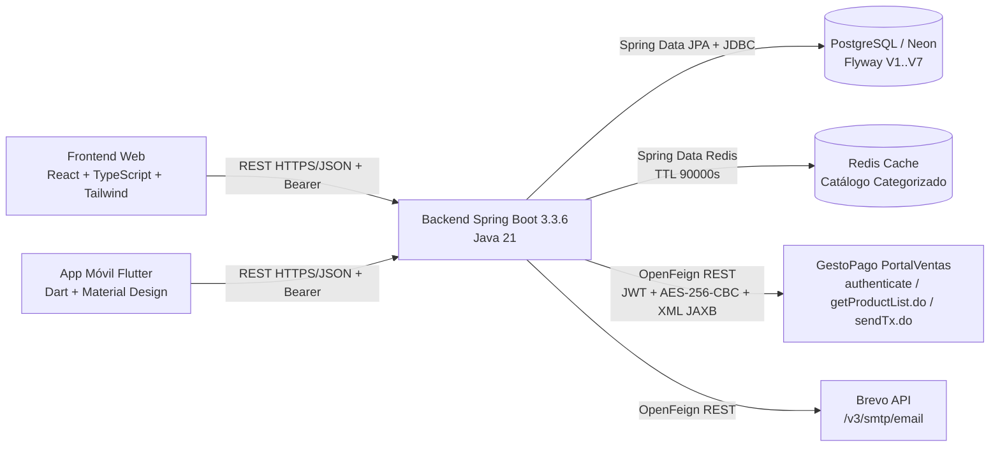

# Documento Técnico de Arquitectura e Integración — Plataforma de Pagos de Servicios GestoPagos

## 1. Descripción General del Sistema

**GestoPagos** es una plataforma integral de pagos de servicios y recargas electrónicas integrada con los servicios reales de **GestoPago** mediante arquitectura cliente-servidor multicapa. La solución unifica la experiencia funcional a través de **dos clientes independientes** conectados a la misma API REST:

1. **Aplicación Web (`web/`)**: Desarrollada con **React 18**, **TypeScript**, **Vite** y **Tailwind CSS**, con diseño responsivo (barra lateral en escritorio y barra inferior de navegación en dispositivos móviles).
2. **Aplicación Móvil (`frontend/`)**: Desarrollada con **Flutter** y **Dart** siguiendo lineamientos de **Material Design**, adaptada a múltiples tamaños de pantalla.

Ambas interfaces consumen los **mismos endpoints REST** del backend **Spring Boot**, utilizan las **mismas credenciales de usuario**, operan sobre las **mismas cuentas y saldos en PostgreSQL**, comparten exactamente la **misma lógica de negocio** y ofrecen paridad funcional completa: autenticación, onboarding, consulta de saldo, catálogo dinámico de servicios con logotipos, validación previa de referencias, resumen con confirmación explícita + 2FA, procesamiento y diferenciación de estados de pago, consulta de estatus en vivo e historial filtrado por cuenta con detalle y reenvío de comprobante por correo electrónico.

---

## 2. Arquitectura General y Diagrama de Componentes



---

## 3. Arquitectura por Capas

### 3.1 Backend (`src/main/java/com/proyecto/servicios/`)

El backend sigue una arquitectura limpia en capas con separación explícita de responsabilidades:

| Capa | Paquete / Componentes Clave | Responsabilidad |
| :--- | :--- | :--- |
| **Controladores REST (`controller/`)** | `AuthController`, `ClienteController`, `CuentaController`, `CatalogoController`, `ProductoController`, `PagoServicioController` | Exposición de endpoints JSON, validación declarativa (`@Valid`), cabeceras (`Authorization`, `Idempotency-Key`) y códigos HTTP semánticos (`200`, `202`, `400`, `401`, `403`, `404`, `409`, `422`, `502`, `503`). |
| **Servicios de Negocio (`service/`, `service/Impl/`, `service/cliente/impl/`)** | `AuthServiceImpl`, `ClienteServiceImpl`, `CuentaServiceImpl`, `ProductoServiceImpl`, `PagoServicioServiceImpl`, `PagoLedgerService`, `ConciliacionPagosService`, `GestoPagoTokenServiceImpl`, `ComprobanteEmailServiceImpl` | Reglas financieras, control de sesión (timeout 5 min), libro mayor transaccional en 2 fases, cache-aside Redis/PostgreSQL y envío de comprobantes. |
| **Gateways y Clientes Externos (`client/`, `service/GestoPagoSendTxGateway`)** | `GestoPagoAuthClient`, `GestoPagoProductClient`, `GestoPagoSendTxGateway`, `BrevoEmailClient` | Comunicación HTTP con GestoPago y Brevo mediante OpenFeign sin reintentos ciegos (`Retryer.NEVER_RETRY`), parseo XML endurecido contra XXE y clasificación de veredictos (`EXITO`, `RECHAZADO`, `INDETERMINADO`). |
| **Procesos Programados (`cron/`)** | `CatalogoProductosCron`, `ConciliacionPagosCron` | Sincronización diaria del catálogo de productos a las `06:00 AM` (`0 0 6 * * *`, zona `America/Mexico_City`) y conciliación periódica de operaciones pendientes cada `120000 ms`. |
| **Repositorios y Entidades (`repositorys/`, `entity/`)** | `Cliente`, `Cuenta`, `Saldo`, `UsuarioLogin`, `SesionLogin`, `Nacionalidad`, `GestoPagoToken`, `GestoPagoProducto`, `GestoPagoTransaccion` | Persistencia JPA sobre PostgreSQL gestionada con migraciones Flyway (`V1` a `V7`). |
| **Seguridad, Validación y Excepciones (`config/`, `validation/`, `exception/`, `util/`)** | `StrictTwoDecimalNumberDeserializer`, `ExactamenteDosDecimalesValidator`, `PasswordEncryptionUtil`, `BiometriaFacialUtil`, `AesEncryption`, `DatosSensibles`, `LogoServicioResolver`, `GlobalExceptionHandler`, `CatalogoCodigoError`, `CorsConfig` | Deserialización monetaria estricta a 2 decimales, hashing `PBKDF2WithHmacSHA256`, similitud coseno para biometría, cifrado `AES/CBC/PKCS5Padding`, sanitización de logs y enmascaramiento de cuentas. |

---

### 3.2 Frontend Web (`web/src/`)

El cliente Web es un proyecto independiente construido con **React 18 + TypeScript + Vite 2.9 + Tailwind CSS**:

```text
web/src/
├── core/
│   ├── config/appConfig.ts               # URL configurable del backend (presets + localStorage)
│   ├── network/strictDecimal.ts          # Serialización JSON numérica exacta a 2 decimales (X.XX)
│   ├── network/apiError.ts               # Parseo de ApiException, detallesValidacion, UPC y 202
│   ├── network/apiClient.ts              # Fetch HTTP client con Bearer automático y detección de expiración
│   ├── validation/backendValidators.ts   # Validadores alineados a las anotaciones del backend
│   ├── utils/formatters.ts               # Formateo MXN, fechas, enmascaramiento y cuenta regresiva
│   ├── session/SessionContext.tsx        # Estado global de sesión, timeout 5 min y perfil/saldo
│   └── components/UiPrimitives.tsx       # ErrorBanner, ServiceLogo, StatusBadge, ServerConfigModal
└── features/
    ├── auth/                             # authRepository + LoginView (contraseña / biometría)
    ├── onboarding/                       # OnboardingModal (wizard 4 pasos + nacionalidades BD)
    ├── cuentas/                          # cuentaRepository + CuentaTab (tarjeta, desglose contable)
    ├── catalogo_productos/               # productoRepository + CatalogoTab (categorías, logos, legend)
    ├── pagos/                            # pagoRepository + PagoFlowModal (3 fases) + HistorialTab
    ├── clientes/                         # clienteModels + clienteRepository + PerfilTab + ClienteEditModal
    ├── catalogos_sistema/                # nacionalidadRepository
    ├── cliente_portal/                   # ClientePortalView (navegación responsiva Web)
    └── backoffice/                       # BackofficeView (gestión clientes, cuentas, UPC y catálogos)
```

---

### 3.3 Aplicación Móvil (`frontend/lib/`)

La aplicación Flutter sigue una arquitectura paralela por capas (`core/` + `features/*/data` + `features/*/presentation`) con Material Design:

```text
frontend/lib/
├── app/                                  # Enrutador y tema Material
├── core/
│   ├── config/app_config.dart            # URL del backend configurable
│   ├── network/                          # dio_client.dart, api_error.dart, strict_decimal_json.dart
│   ├── validation/backend_validators.dart
│   └── widgets/app_feedback.dart
└── features/
    ├── auth/                             # auth_repository.dart, session_controller.dart, login_screen.dart
    ├── onboarding/                       # onboarding_wizard_screen.dart
    ├── cuentas/                          # cuenta_home_tab.dart
    ├── catalogo_productos/               # producto_repository.dart, catalogo_productos_tab.dart
    ├── pagos/                            # pago_repository.dart, pago_screen.dart, pago_resultado_views.dart, historial_tab.dart
    ├── clientes/                         # cliente_models.dart, cliente_repository.dart, perfil_tab.dart, cliente_edit_screen.dart
    ├── cliente_portal/                   # cliente_shell_screen.dart
    └── backoffice/                       # backoffice_screen.dart
```

---

## 4. Servicios Consumidos de GestoPago y Otros Proveedores

### 4.1 API de GestoPago (`https://gestopago.portalventas.net`)

1. **Autenticación JWT (`GestoPagoAuthClient`)**
   - **Operación:** `POST /sistema/app/jwt-gp/authenticate/`
   - **Parámetros:** `idDistribuidor`, `codigoDispositivo`, `password` (inyectados únicamente por variables de entorno).
   - **Gestión de token (`GestoPagoTokenServiceImpl`):** Renueva automáticamente con verificación programada (`fixedRateString = ${gestopago.auth.refresh-rate-ms:3600000}`), conserva el token en memoria y PostgreSQL (`V1__create_gestopago_tokens.sql`) con ventana de vigencia segura de 20 horas para evitar solicitar un token por petición.

2. **Consulta Dinámica del Catálogo (`GestoPagoProductClient` + `ProductoServiceImpl`)**
   - **Operación:** `GET /sistema/app/service/getProductList.do`
   - **Flujo:** `CatalogoProductosCron` actualiza diariamente el catálogo en Redis (`gestopago:catalogo:productos_por_tipo_front`, TTL `90000` segundos) y PostgreSQL (`V2`, `V6`), normalizando categorías, descripción/leyenda (`legend`), flujo (`tipoFront`), tipo de referencia (`tipoReferencia`), bandera de dígito verificador (`hasDigitoVerificador`) y logotipos de proveedores (`LogoServicioResolver`). Si Redis no está disponible, consulta la base de datos como respaldo (`DATABASE_FALLBACK`).

3. **Procesamiento Transaccional (`GestoPagoSendTxGateway` + `PagoServicioServiceImpl`)**
   - **Operación:** `POST /sistema/app/service/sendTx.do`
   - **Cifrado (`AesEncryption`):** El payload JSON (`SendTxPayloadDto`: `idProducto`, `idServicio`, `telefono`, `referencia`, `horaLocal`, `montoPago`, `upc`, `unidad="083"`) se serializa y cifra con **AES-256-CBC (`AES/CBC/PKCS5Padding`)** antes de tocar el saldo.
   - **Parámetros HTTP enviados:** Cabecera `Authorization: Bearer <JWT>`, formulario `random` (`timestamp_UPC`) y `signed` (payload cifrado).
   - **Parsing XML endurecido:** `GestoPagoSendTxGateway` deserializa la respuesta XML con JAXB y `XMLInputFactory` deshabilitando DTDs y entidades externas para prevenir ataques XXE.
   - **Clasificación de veredictos:**
     - `CODIGO = "01"` -> **`EXITO`**: confirma el cargo contable (`EXITOSA`) y retorna folio `numAutorizacion`, `idTx` y `upc`.
     - Códigos `"07"`, `"08"`, `"82"`, HTTP `5xx`, timeout o respuesta ilegible -> **`INDETERMINADO`**: conserva el monto retenido (`PENDIENTE_CONCILIACION`, HTTP `202`) para resolución segura mediante `ConciliacionPagosCron`.
     - HTTP `4xx` o rechazo explícito del proveedor -> **`RECHAZADO`**: libera la retención en `saldoDisponible` (`RECHAZADA`).

### 4.2 API de Correo Transaccional Brevo (`BrevoEmailClient`)
- **Operación:** `POST https://api.brevo.com/v3/smtp/email`
- **Uso:** Envío automático o manual bajo demanda del comprobante digital al cliente (`POST /pagos/enviar-comprobante`).

---

## 5. Catálogo de Endpoints REST Consumidos por Web y Móvil

| Módulo | Método | Endpoint | Función Principal |
| :--- | :--- | :--- | :--- |
| **Autenticación** | `POST` | `/auth/login` | Inicio de sesión con correo + contraseña cifrada o vector biométrico facial; devuelve `tokenSesion` y límite de `5` minutos de inactividad. |
| **Autenticación** | `GET` | `/auth/validar-sesion` | Verifica vigencia del token Bearer y renueva el reloj deslizante de inactividad por 5 minutos adicionales. |
| **Autenticación** | `POST` | `/auth/logout` | Inactiva inmediatamente la sesión activa en base de datos. |
| **Catálogo** | `GET` | `/productos` | Devuelve productos reales agrupados por categoría (`tipoFront` / categoría normalizada) con logotipos, IDs y leyendas. |
| **Pagos** | `POST` | `/pagos/validar-referencia` | Valida formato, reglas del producto en catálogo, estado de cuenta y suficiencia de saldo previo al pago; retorna resumen normalizado (`ValidarReferenciaResponse`). |
| **Pagos** | `POST` | `/pagos` | Procesa pago con cabecera `Idempotency-Key`, monto estricto a 2 decimales y factor `2fa`; devuelve `200` (`EXITOSA`), `202` (`PENDIENTE_CONCILIACION`) o error (`400/401/403/409/422/502`). |
| **Pagos** | `GET` | `/pagos/estatus/{upc}` | Consulta estado actual (`EXITOSA`, `RECHAZADA`, `PENDIENTE_CONCILIACION`, `PROCESANDO`, `REVISION_MANUAL`) por UPC de 10 caracteres. |
| **Pagos** | `POST` | `/pagos/historial` | Lista las transacciones de la cuenta autenticada enriquecidas con `servicio`, `producto` y `urlLogo`. |
| **Pagos** | `POST` | `/pagos/enviar-comprobante` | Envía o reenvía el comprobante digital vía Brevo. |
| **Clientes** | `POST` | `/clientes` | Registra nuevo cliente + domicilio + cuenta bancaria de 16 dígitos + saldo inicial + credenciales compartidas. |
| **Clientes** | `POST` | `/clientes/consultar` | Obtiene perfil, domicilios, cuentas y saldo actual por identificador (`email`, `CURP`, `RFC` o `numeroCuenta`). |
| **Clientes** | `POST` | `/clientes/buscar` | Búsqueda operativa multicriterio para consola administrativa. |
| **Clientes** | `PUT` / `PATCH` | `/clientes` | Actualización completa (`PUT`) o parcial (`PATCH`, incluyendo activación/baja lógica). |
| **Cuentas** | `GET` | `/cuentas/{numeroCuenta}` | Consulta detalle de una cuenta bancaria específica. |
| **Cuentas** | `GET` | `/cuentas/activas` | Lista cuentas activas en la plataforma. |
| **Cuentas** | `POST` | `/cuentas/consultar-saldo` | Consulta saldo disponible y contable actualizado de la cuenta. |
| **Catálogos BD** | `GET` | `/catalogos/nacionalidades` | Lista nacionalidades oficiales persistidas en PostgreSQL. |
| **Catálogos BD** | `POST` | `/catalogos/nacionalidades/buscar` | Busca nacionalidad por código ISO, país o gentilicio. |

---

## 6. Mecanismos de Seguridad, Consistencia Financiera y Calidad

1. **Credenciales y Cifrado en Reposo y Tránsito:**
   - Contraseñas protegidas con **`PBKDF2WithHmacSHA256`** (`65,536` iteraciones, clave de `256` bits y salt criptográfico aleatorio de `16` bytes) con comparación en tiempo constante (`PasswordEncryptionUtil`).
   - Biometría facial validada mediante similitud de coseno con umbral mínimo de `0.80` (`BiometriaFacialUtil`).
   - Ningún secreto productivo se incluye en el código fuente: las credenciales de BD, GestoPago, llaves AES-256-CBC y Brevo se inyectan mediante variables de entorno (`DB_USERNAME`, `DB_PASSWORD`, `GESTOPAGO_CODIGO_DISPOSITIVO`, `GESTOPAGO_AUTH_PASSWORD`, `GESTOPAGO_AES_SECRET_KEY`, `GESTOPAGO_AES_IV`, `BREVO_API_KEY`).

2. **Control de Sesiones:**
   - Al autenticar un usuario se revocan sus sesiones activas previas y se emite un token UUID con caducidad de **5 minutos de inactividad** (`AuthServiceImpl`).
   - Tanto Web (`SessionContext.tsx`) como Flutter (`SessionController`) monitorean el temporizador en pantalla, renuevan la sesión con `GET /auth/validar-sesion` ante actividad del usuario y cierran sesión automáticamente si expira o si el usuario ejecuta `POST /auth/logout`.

3. **Consistencia Monetaria y Libro Mayor en Dos Fases (`PagoLedgerService`):**
   - `StrictTwoDecimalNumberDeserializer` y `StrictDecimal` (en Web y Flutter) impiden ambigüedades de coma flotante exigiendo números JSON directos sin comillas con exactamente dos decimales.
   - **Fase 1 (`reservar`):** Bajo bloqueo pesimista (`findByNumeroCuentaForUpdate`), valida `Idempotency-Key`, ventana anti-duplicados de `120` segundos y saldo suficiente, reteniendo el monto en `saldoDisponible` y creando el registro `PROCESANDO`.
   - **Llamada Externa Sin Bloqueo de BD:** La invocación a `sendTx.do` se ejecuta fuera de transacciones abiertas (`connect-timeout=10s`, `read-timeout=65s`).
   - **Fase 2:** `confirmarExito` consolida `saldoContable`; `liberarRetencion` devuelve fondos ante rechazo explícito; `marcarPendiente` preserva la retención ante respuestas inciertas (`202 Accepted`) hasta que `ConciliacionPagosCron` (hasta `5` intentos cada `2+` minutos reutilizando el mismo UPC) o `GET /pagos/estatus/{upc}` obtengan el veredicto definitivo.

4. **Validación Previa Obligatoria de Referencias (`POST /pagos/validar-referencia`):**
   - Impide avanzar al paso de confirmación cuando la referencia/teléfono no cumple formato alfanumérico (`tipoFront = 2`) o numérico a 10 dígitos (`tipoFront = 1`), cuando el servicio no existe en catálogo o cuando el saldo es insuficiente.
   - Si el usuario modifica la referencia, teléfono o monto en cualquiera de las dos aplicaciones, la validación previa se invalida obligando una nueva verificación antes de habilitar la confirmación explícita y envío del pago.

---

## 7. Escenarios de Pruebas Funcionales Obligatorias

| # | Escenario Obligatorio | Endpoints Involucrados | Resultado Esperado en Web y Móvil |
| :-: | :--- | :--- | :--- |
| **1** | Inicio de sesión desde la aplicación Web | `POST /auth/login`, `POST /clientes/consultar`, `POST /cuentas/consultar-saldo` | Autenticación válida, almacenamiento de token en `sessionStorage`, carga de perfil y saldo compartido; bloqueo ante contraseña incorrecta. |
| **2** | Inicio de sesión desde la app móvil Flutter con el mismo usuario | `POST /auth/login`, `POST /clientes/consultar`, `POST /cuentas/consultar-saldo` | Acceso exitoso con las mismas credenciales, visualizando exactamente la misma cuenta de 16 dígitos, saldo e historial generado en Web. |
| **3** | Consulta dinámica del catálogo de servicios | `GET /productos` | Listado en tiempo real agrupado por categorías (`tipoFront` / categoría), con ID de servicio, ID de producto, descripción/`legend` y buscador. |
| **4** | Visualización de logotipos de proveedores | `GET /productos`, `POST /pagos/historial` | Despliegue del logotipo correspondiente (`urlLogo`) en tarjetas del catálogo, resumen de pago e historial, con ícono de respaldo controlado si la URL falla. |
| **5** | Validación de una referencia correcta | `POST /pagos/validar-referencia` | Respuesta `valida=true`, datos normalizados del servicio, comisión/monto estimados y habilitación del paso de resumen y confirmación explícita. |
| **6** | Rechazo de una referencia incorrecta | `POST /pagos/validar-referencia` | Validación local y/o rechazo HTTP `400`/`422` o `valida=false`; se muestra mensaje claro y **se bloquea el botón para continuar al pago**. |
| **7** | Confirmación explícita de un pago | Checkbox confirmación + `2fa` + `POST /pagos` (con `Idempotency-Key`) | Muestra resumen completo previo, exige confirmación explícita del usuario y factor `2fa` antes de invocar `POST /pagos`. |
| **8** | Visualización diferenciada del resultado transaccional | `POST /pagos`, `GET /pagos/estatus/{upc}`, `POST /pagos/enviar-comprobante` | Diferenciación visual y funcional entre **`EXITOSA`** (folio UPC, autorización, saldo actualizado, comprobante por correo), **`PENDIENTE_CONCILIACION`** (`202` con seguimiento en vivo por UPC) y **`RECHAZADA`** (sin cargo aplicado). |
| **9** | Consulta del historial de pagos | `POST /pagos/historial`, `GET /pagos/estatus/{upc}` | Lista exclusiva de las operaciones de la cuenta autenticada con logotipo, nombre del servicio, fecha, referencia, monto, UPC/autorización, estado y vista de detalle. |
| **10** | Paridad operativa entre ambas plataformas | Todos los anteriores en `web/` y `frontend/` | Un pago o actualización realizada en Web se refleja de inmediato en saldo e historial de Flutter y viceversa sobre la misma base de datos PostgreSQL. |
