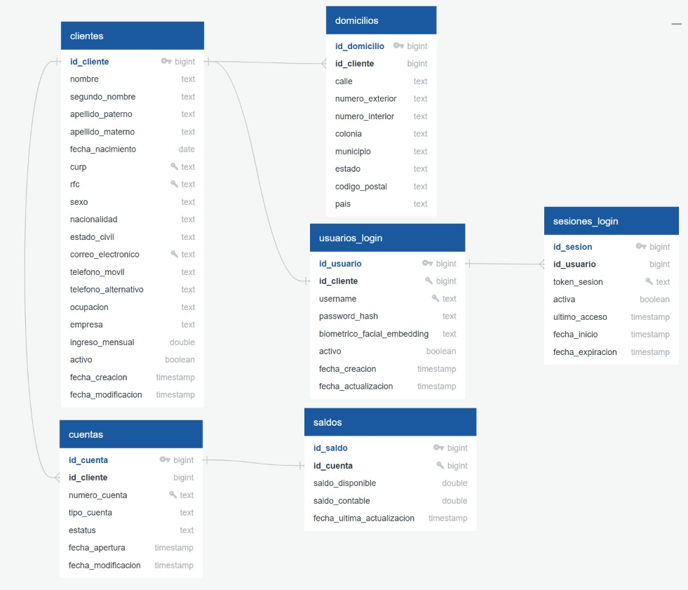

# Plataforma de Pagos de Servicios GestoPagos (Backend + Web + Flutter)

## 1. Documentación Técnica

- 📄 **Documento Técnico del Proyecto (Arquitectura, APIs, Seguridad y Pruebas):** [`DOCUMENTO_TECNICO.md`](DOCUMENTO_TECNICO.md)
- 📄 **Documento Técnico Base (referencia original):** [Documento Técnico en Drive](https://drive.google.com/file/d/1Amqv0GMp_M2kMNHbXpml_NQJIPlfUq8K/view?usp=sharing)

---

## 2. Instrucciones de Ejecución y Compilación

### A. Backend Spring Boot (Java 21)

1. **Compilar el proyecto:**
   ```powershell
   ./gradlew compileJava
   ```

2. **Ejecutar la aplicación Spring Boot (puerto `8080`):**
   ```powershell
   ./gradlew bootRun
   ```

3. **Ejecutar pruebas unitarias e integración:**
   ```powershell
   ./gradlew test
   ```

4. **Construir el artefacto ejecutable (JAR):**
   ```powershell
   ./gradlew build -x test
   ```

5. **Documentación Swagger / OpenAPI:**  
   `http://localhost:8080/swagger-ui/index.html`

### B. Frontend Web Responsivo (`web/` — React 18 + TypeScript + Vite + Tailwind CSS)

1. **Instalar dependencias y levantar entorno de desarrollo:**
   ```powershell
   cd web
   npm install
   npm run dev
   ```
   *(Por defecto apunta a `http://localhost:8080`, configurable desde la UI en "Configurar backend" o con `VITE_API_BASE_URL`.)*

2. **Verificación de tipos y compilación de producción:**
   ```powershell
   cd web
   npm run build
   ```

### C. Aplicación Móvil Flutter (`frontend/` — Dart + Material Design)

1. **Analizar y ejecutar pruebas unitarias:**
   ```powershell
   cd frontend
   flutter pub get
   flutter analyze
   flutter test
   ```

2. **Ejecutar aplicación móvil:**
   ```powershell
   cd frontend
   flutter run
   ```

---

## 3. Diagrama Entidad-Relación (ER)

El archivo del diagrama se encuentra en:
📁 **`resources/diagrama.png`**



---

## 4. Catálogo de Endpoints REST

| Método | Endpoint | Descripción |
| :--- | :--- | :--- |
| **POST** | `/auth/login` | Iniciar sesión (contraseña cifrada o biometría MediaPipe). |
| **GET** | `/auth/validar-sesion` | Validar y renovar sesión activa (timeout de 5 min por inactividad). |
| **POST** | `/auth/logout` | Cierre voluntario de sesión. |
| **GET** | `/productos` | Catálogo dinámico categorizado de productos y servicios GestoPago con logotipos. |
| **POST** | `/pagos/validar-referencia` | Validación previa de referencia/teléfono, producto, monto y suficiencia de saldo antes del pago. |
| **POST** | `/pagos` | Procesar pago con `Idempotency-Key`, 2FA, cifrado AES-256-CBC y reserva de saldo en 2 fases. |
| **GET** | `/pagos/estatus/{upc}` | Consultar estatus en vivo de una transacción por UPC (10 caracteres). |
| **POST** | `/pagos/historial` | Consultar historial de pagos de la cuenta autenticada con detalle de servicio y logotipo. |
| **POST** | `/pagos/enviar-comprobante` | Enviar o reenviar comprobante digital por correo electrónico (Brevo). |
| **POST** | `/clientes` | Onboarding de cliente (cliente + domicilio + cuenta + saldo + usuario login). |
| **POST** | `/clientes/consultar` | Consultar perfil y cuentas por identificador (CURP, RFC, correo o número de cuenta). |
| **POST** | `/clientes/buscar` | Búsqueda avanzada multicriterio de clientes. |
| **PUT** | `/clientes` | Actualización completa de cliente. |
| **PATCH** | `/clientes` | Actualización parcial (incluye reactivación o baja lógica con `activo`). |
| **GET** | `/cuentas/{numeroCuenta}` | Consultar cuenta bancaria por número único de 16 dígitos. |
| **GET** | `/cuentas/activas` | Consultar todas las cuentas bancarias activas. |
| **POST** | `/cuentas/consultar-saldo` | Consultar saldo disponible y contable actualizado de la cuenta. |
| **GET** | `/catalogos/nacionalidades` | Consultar catálogo de nacionalidades desde la BD. |
| **POST** | `/catalogos/nacionalidades/buscar` | Buscar nacionalidad por código ISO, país o gentilicio. |

---

## 5. Pruebas Rápidas con cURL (Listas para Terminal / Postman)

### A. Consultar Catálogo de Nacionalidades (Base de Datos)
```bash
curl -X GET "http://localhost:8080/catalogos/nacionalidades"
```

### B. Registro de Cliente (Onboarding)
```bash
curl -X POST "http://localhost:8080/clientes" \
  -H "Content-Type: application/json" \
  -d '{
    "nombre": "Juan",
    "segundoNombre": "Carlos",
    "apellidoPaterno": "Perez",
    "apellidoMaterno": "Lopez",
    "fechaNacimiento": "1992-05-20",
    "curp": "PELJ920520HDFRRN09",
    "rfc": "PELJ9205201A0",
    "sexo": "Masculino",
    "idNacionalidad": 1,
    "nacionalidad": "Mexicana",
    "estadoCivil": "Soltero",
    "correoElectronico": "juan.perez@example.com",
    "telefonoMovil": "5512345678",
    "telefonoAlternativo": "5587654321",
    "domicilio": {
      "calle": "Av. Insurgentes Sur",
      "numeroExterior": "1602",
      "numeroInterior": "Piso 4",
      "colonia": "Credito Constructor",
      "municipio": "Benito Juarez",
      "estado": "Ciudad de Mexico",
      "codigoPostal": "03940",
      "pais": "Mexico"
    },
    "ocupacion": "Ingeniero de Software",
    "empresa": "Tech Solutions",
    "ingresoMensual": 45000.00,
    "saldoInicial": 2500.00,
    "password": "PasswordSeguro123*",
    "biometricoFacialEmbedding": "[0.12, -0.45, 0.89, -0.05, 0.67]"
  }'
```

### C. Actualización Parcial (PATCH)
```bash
curl -X PATCH "http://localhost:8080/clientes/1" \
  -H "Content-Type: application/json" \
  -d '{
    "telefonoMovil": "5599887766",
    "ingresoMensual": 55000.00,
    "ocupacion": "Lead Architect"
  }'
```

### C. Consultar Saldo de Cuenta
```bash
curl -X GET "http://localhost:8080/cuentas/1000000001/saldo" \
  -H "Accept: application/json"
```

### D. Login con Contraseña (Inicia Sesión de 5 min)
```bash
curl -X POST "http://localhost:8080/auth/login" \
  -H "Content-Type: application/json" \
  -d '{
    "username": "juan.perez@example.com",
    "password": "PasswordSeguro123*"
  }'
```

### E. Login con Biometría Facial (MediaPipe)
```bash
curl -X POST "http://localhost:8080/auth/login" \
  -H "Content-Type: application/json" \
  -d '{
    "username": "juan.perez@example.com",
    "biometricoFacialEmbedding": "[0.12, -0.45, 0.89, -0.05, 0.67]"
  }'
```

### F. Validar Sesión Activa (Verifica y renueva timeout de 5 min)
```bash
curl -X GET "http://localhost:8080/auth/validar-sesion" \
  -H "Authorization: Bearer <TOKEN_DE_SESION>"
```

### G. Baja Lógica (DELETE)
```bash
curl -X DELETE "http://localhost:8080/clientes/1"
```

---

## 6. Pagos GestoPago: diseño, riesgos y secretos

### Secretos
Ningún secreto vive en el repositorio. Define como variables de entorno: `DB_USERNAME`, `DB_PASSWORD`, `GESTOPAGO_CODIGO_DISPOSITIVO`, `GESTOPAGO_AUTH_PASSWORD`, `GESTOPAGO_AES_SECRET_KEY`, `GESTOPAGO_AES_IV`, `BREVO_API_KEY`. En local se leen de `config/application.properties` (ignorado por git).

### Flujo de `POST /pagos`
1. Validación: catálogo (servicio/producto/monto), cuenta activa, cliente activo, 2FA.
2. Cifrado AES del payload (antes de tocar el saldo).
3. Reserva atómica: bloqueo pesimista del saldo, anti-duplicados, saldo suficiente, retención y registro `PROCESANDO` en un solo commit.
4. Llamada a `sendTx.do` **sin transacción abierta**, con timeouts y sin reintentos automáticos.
5. Cierre según veredicto:
   - `01` -> confirma el cargo (`EXITOSA`).
   - Rechazo explícito del proveedor -> libera la retención (`RECHAZADA`).
   - Timeout, 5xx, `07`/`08` o respuesta ilegible -> `PENDIENTE_CONCILIACION`, dinero retenido, HTTP 202.
6. Un job concilia pendientes reutilizando el mismo UPC; `06` o intentos agotados pasan a `REVISION_MANUAL`.

Cabecera opcional `Idempotency-Key` (8-64 caracteres). Consulta de estatus: `GET /pagos/estatus/{upc}`.

### Códigos HTTP
`400` datos inválidos · `401/403` 2FA/usuario · `404` recurso inexistente · `409` solicitud duplicada · `422` saldo insuficiente / monto no permitido · `202` pendiente de conciliación · `502` falla del proveedor (incluye `55` IP no autorizada) · `500` error interno genérico.

